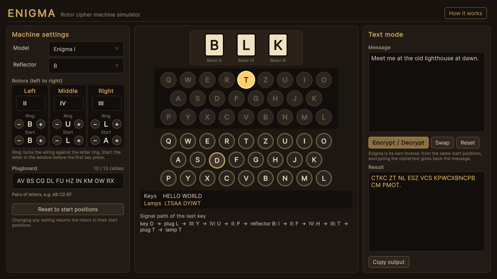
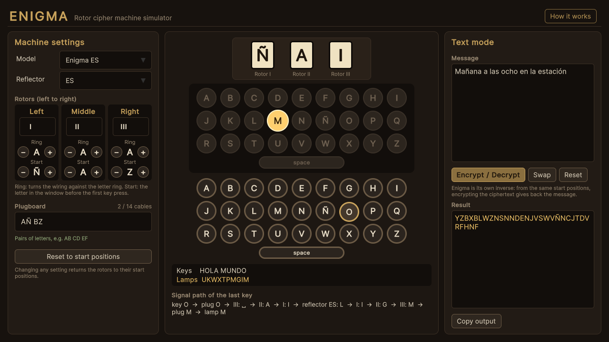
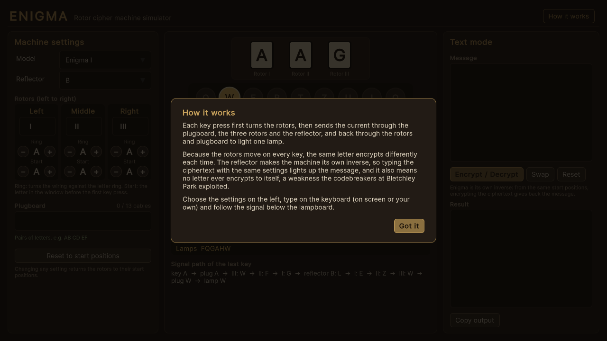

# Enigma

An interactive simulator of the Enigma rotor cipher machine, built with Unity: set the
rotors, rings and plugboard, type on the keyboard, and watch the rotors turn, the lamps
light up and the electrical signal travel through every wheel.



| | |
|---|---|
|  |  |

## Run it

1. Install **Unity 6000.3.27f1 (Unity 6 LTS)** with Unity Hub.
2. In Unity Hub choose **Add → Add project from disk** and select the `Project_Enigma`
   folder.
3. Open `Assets/Scenes/Main.unity` and press **Play**.

To build a player use **File → Build Profiles** (Windows or Web), or build from a
terminal into a folder outside the repository:

```bash
Unity -batchmode -quit -projectPath Project_Enigma -executeMethod EnigmaCipher.EditorTools.ProjectBuilder.BuildWebGL -buildOutput ../build/web
```

(`BuildWindows` works the same way.)

The tests run from **Window → General → Test Runner → EditMode**, or from a terminal:

```bash
Unity -batchmode -projectPath Project_Enigma -runTests -testPlatform EditMode -testResults results.xml
```

## How to use it

- **Machine settings** (left): pick the model and reflector, the rotor in each slot,
  its ring setting and start letter, and plugboard cables such as `AB CD EF`.
- **Keyboard and lamps** (centre): click the keys or type on your own keyboard. The
  lamp of the encrypted letter lights up, the rotor windows advance, and the signal
  path of the last key is shown below.
- **Text mode** (right): encrypt or decrypt a whole message from the start positions.
  Enigma is its own inverse, so the same button does both.

Two machines are included:

- **Enigma I**: the historical Wehrmacht machine, with rotors I–V, reflectors B and C,
  and the real wirings and turnover notches.
- **Enigma ES**: a fictional machine for Spanish, with the 27 letters of the Spanish
  alphabet (including Ñ) plus the space. A reflector swaps symbols in pairs, so it
  needs an even number of them; encrypting spaces also hides word boundaries.
  Accented vowels are typed as their base letter.

## What I learned / technically interesting

- **Engine-independent core.** The cipher (`Assets/Scripts/Core`) is plain C# with no
  Unity references, in its own assembly. The UI only drives a `MachineSession`, which
  is also plain C#, so both are unit-tested without rendering anything (33 EditMode
  tests).
- **Getting the mechanics right.** The tests pin the published test vectors
  (`AAAAA` → `BDZGO` with rotors I-II-III and reflector B, and `EWTYX` with rings
  BBB) and the middle rotor's double step (ADU → ADV → AEW → BFX). Writing them caught
  a typo in a reflector wiring before the code ever ran.
- **Reciprocity and its weakness.** Because the reflector pairs letters, encryption is
  its own inverse and no letter can ever encrypt to itself, the property the
  codebreakers at Bletchley Park used to rule out guesses. The app explains this in its
  "How it works" panel.
- **UI Toolkit.** The interface is UXML + USS (text files that review well), scaled to
  fit any 16:9 window, the browser included. A small editor script generates the scene,
  the panel settings, the app icon and the player settings, so they can be recreated
  from code.
- **Upgrading old work.** This started as a university assignment in Unity 2020.1 that
  stored the machine's state in UI text fields. It was upgraded to Unity 6, the logic
  was rewritten around the real machine, and the UI was rebuilt from scratch.

## Credits

- Rotor and reflector wirings of the Enigma I are historical facts.
- The UI uses Unity's default runtime font. The app icon is generated in code.
- No third-party assets are included.

## License

[MIT](LICENSE)
